# ResaleDB schema proposal (draft for review)

Status: **approved with changes, nothing built yet.** Branch `sqlserver-migration`.
Draft 2026-11-02; revised 2026-11-02 after review.
Readers: Person A (bot, pricing, listings) and Person B (databases, receipts, buying).
Sign-off: Person B approved the design and answered their questions. Person A's
answers were relayed by Person B and still need Person A's own confirmation.
Section 8 lists every decision.

Numbers below come from the **dev copy** of `ross.db` (162 items) and from
`ReceiptsDB` (212 receipts, 2,704 lines), both read-only. The migration script
re-counts everything on the day it runs (section 7).

---

## 0. The short version

- One database, **ResaleDB**, on `.\SQLEXPRESS`, Windows auth. It holds the bot,
  the receipts and the home inventory.
- The SQLite `items` row (11 JSON columns) splits into **one row per group**:
  `items` + 1:1 tables `item_identification`, `item_pricing`, `item_listing`,
  `ebay_listings`, `item_tags`. The groups are the same ones `db.update_field`
  uses today, so each update touches one table and only the columns that changed.
- Lists become child tables: `item_photos`, `listing_images`,
  `listing_specifics`, `item_flags`, `sales`, `listing_checks` plus
  `listing_check_issues`, and `offer_plan_rows`.
- **Every pricing run is kept:** `pricing_runs` holds one row per run, with its
  comps in `pricing_comps`. `item_pricing.latest_run_id` points at the current
  one.
- **`pieces` is the only place a physical location lives.** `items.stock`
  goes away. Locations get their own table. The code format is a config regex,
  not a DB rule.
- `Receipts` and `ReceiptItems` move in **with the same names and columns**,
  so the receipt bot only needs a new `SQL_CONN_STR`.
- Receipt lines link to pieces/items through **`receipt_matches`**
  (SKU + price, with the date used only to rule matches out; method,
  confidence, proposed/confirmed).
- **Receipts are optional enrichment.** Many items will never have a receipt
  match, and nothing requires one. Cost uses a confirmed receipt price, else
  the tag price, else none. Tax is added on top with a configurable rate.
- Every timestamp is **UTC `DATETIME2(6)`**. Money is `DECIMAL(10,2)`.
- `db.py` keeps every public name and signature. Callers don't change in
  phase 1.

### Design rules

| Rule | Detail |
|---|---|
| Names | New tables are `snake_case` in `dbo`. `Receipts`/`ReceiptItems` keep their PascalCase names for compatibility. |
| Keys | `items.item_id` stays the existing lowercase UUID string as `VARCHAR(36)`, not `UNIQUEIDENTIFIER`. pyodbc returns that type upper-cased, which would break id comparisons and Telegram callback data. |
| Time | `DATETIME2(6)`, UTC always, column names end in `_at`, default `SYSUTCDATETIME()`. `db.py` hands out aware ISO strings (`...+00:00`), as it does today. |
| Money | `DECIMAL(10,2)`. LLM cost is `DECIMAL(18,10)`. |
| Flags | `BIT`. |
| Text | `NVARCHAR` for anything a human or an AI wrote. `VARCHAR` for codes and ids. |
| JSON | `NVARCHAR(MAX)` with `CHECK (ISJSON(col) = 1)`, named `*_raw`. See the JSON rule below. |
| FKs | On by default. Child tables `ON DELETE CASCADE` from `items`, **except `sales`** (deleting a sold item must fail) and logs (`llm_usage`, `offer_sends`), which get no FK so history survives. |
| Concurrency | `ALTER DATABASE ResaleDB SET READ_COMMITTED_SNAPSHOT ON`: readers never block writers, like WAL today. `items.row_ver ROWVERSION` for optional optimistic checks. |
| Collation | `SQL_Latin1_General_CP1_CI_AS`, the same as ReceiptsDB, so cross-database joins work during cutover. It is case-insensitive. See open question Q9. |

### The JSON rule

> Raw JSON may be **read whole** for display or as **prompt input** for the
> next AI step. Code must never filter, branch, sort, do arithmetic or report on a
> key inside it. Anything that needs that is a real column.

This needs saying because the pipeline does read some AI output today. For
example, `identification.specifications` feeds `pipeline/specifics.py`, and
`price_evidence` feeds `pricing_v2`. Those uses are prompt input, so the keys
stay JSON. Their **result** is stored in columns (`listing_specifics`,
`item_pricing.*`).

---

## 1. Tables

### 1A. Items: one row per listing or stock record

**`items`**: the core row. Status, origin, stock-level fields.

| Column | Type | Null | Notes |
|---|---|---|---|
| item_id | VARCHAR(36) | PK | existing UUID |
| status | VARCHAR(20) | NO, default `'captured'` | CHECK in `VALID_STATUSES` |
| origin | VARCHAR(20) | yes | `intake` / `inventory` / `find` / `external` (from `stock.source`, `ebay.source`) |
| quick_price | DECIMAL(10,2) | yes | `stock.quick_price.price` |
| quick_price_basis | NVARCHAR(100) | yes | `stock.quick_price.basis` |
| quick_price_rough | BIT | yes | `stock.quick_price.rough` |
| post_ready | BIT | NO, default 0 | `stock.post_ready` |
| post_blocker | NVARCHAR(300) | yes | `stock.post_blocker` |
| photo_order_manual | BIT | NO, default 0 | `photo_layout.manual` |
| photos_as_sent | BIT | NO, default 0 | `photo_layout.as_sent` |
| price_source_url | NVARCHAR(1000) | yes | the old top-level `price_source_url` column |
| extra_raw | NVARCHAR(MAX) JSON | yes | the **leftover** of groups without their own `*_raw` column, as `{group: {key: value}}` (see 5, "Leftovers"). Never read for logic. |
| created_at / updated_at | DATETIME2(6) | NO | UTC |
| row_ver | ROWVERSION | NO | |
| seq | BIGINT IDENTITY | NO | insertion order, like SQLite's rowid; `list_items()` returns items in this order |

Indexes: `(status)`, `(updated_at)`.

**`item_identification`** (1:1, from `identification`): what the item is.

| Column | Type | Notes |
|---|---|---|
| item_id | VARCHAR(36) PK, FK → items CASCADE | |
| brand | NVARCHAR(100) | max seen 34 |
| product_name | NVARCHAR(300) | |
| model | NVARCHAR(150) | |
| item_type | NVARCHAR(100) | |
| color | NVARCHAR(200) | max seen 114 |
| size | NVARCHAR(200) | max seen 104 (free text like `18"W x 12"H`) |
| material | NVARCHAR(200) | |
| condition | NVARCHAR(50) | **normalised (Q10)** to one spelling per condition (e.g. `New With Tags` → `New with tags`). The migration and `db.py` writes both apply the same map; the original text stays in `identification_raw`. |
| upc | VARCHAR(14) | string: keeps leading zeros |
| upc_decoded | BIT | |
| style_code | VARCHAR(60) | `style_code` or `style_number` |
| department | NVARCHAR(30) | |
| gender | NVARCHAR(20) | |
| search_query | NVARCHAR(300) | |
| retail_price | DECIMAL(10,2) | MSRP from identify |
| resale_estimate | DECIMAL(10,2) | |
| confidence | DECIMAL(4,3) | 0–1 float today |
| product_image_url | NVARCHAR(1000) | |
| identification_raw | NVARCHAR(MAX) JSON | full Gemini output (specifications, price_evidence, …) |
| identified_at | DATETIME2(6) | |

Indexes: `(brand)`, `(upc)`, `(item_type)`.

**`item_pricing`** (1:1, from `pricing`): the latest price decision and its main numbers.

| Column | Type | Notes |
|---|---|---|
| item_id | PK, FK CASCADE | |
| latest_run_id | INT FK → pricing_runs (NO ACTION) | the run these numbers came from. NO ACTION avoids two cascade paths from `items`; deleting an item still removes both. |
| suggested_price | DECIMAL(10,2) | |
| machine_price | DECIMAL(10,2) | |
| manual_price | DECIMAL(10,2) | |
| manual_price_at | DATETIME2(6) | |
| claude_price | DECIMAL(10,2) | |
| formula_price | DECIMAL(10,2) | |
| price_basis | VARCHAR(20) | comps / research / manual … |
| confidence | VARCHAR(20) | text here (`low`, `research`, `manual`), unlike identification |
| claude_confidence | VARCHAR(20) | |
| evidence | VARCHAR(10) | solid / thin / none |
| needs_review | BIT | |
| sold_count / active_count | INT | |
| sold_median / sold_p10 / sold_p90 | DECIMAL(10,2) | |
| active_floor / raw_active_floor | DECIMAL(10,2) | |
| dispersion | DECIMAL(6,2) | |
| research_resale | DECIMAL(10,2) | |
| retail_price / resale_estimate | DECIMAL(10,2) | copies made at pricing time |
| comp_warning | NVARCHAR(400) | max seen 251 |
| query_rung | VARCHAR(20) | (`engine` and `query_used` live on `pricing_runs`) |
| rungs_tried | VARCHAR(100) | comma list (display only). The v2 engine stores whole search queries here, which don't fit; those stay in the leftover |
| stock_image_url | NVARCHAR(1000) | |
| value_notes | NVARCHAR(2000) | Claude price notes (display) |
| pricing_raw | NVARCHAR(MAX) JSON | store_estimate, claude_reasoning/evidence, disagreements, dropped, raw_counts, price_evidence, … |
| priced_at | DATETIME2(6) | |

The comp lists (`sold_comps`, `active_listings`, `judged_comps`, `reference`)
go to `pricing_comps` under the run that produced them. `review_flags` goes to
`item_flags`.

**`pricing_runs`**: one row per time an item was priced. Every run is kept, for
backtests.

| Column | Type | Notes |
|---|---|---|
| run_id | INT IDENTITY PK | |
| item_id | VARCHAR(36) FK → items CASCADE | |
| priced_at | DATETIME2(6) NOT NULL | UTC |
| engine | VARCHAR(10) | e.g. `v2` |
| query_used | NVARCHAR(300) | search query the comps came from |

Index: `(item_id, priced_at DESC)`.

Each re-price **inserts a new run** with its comps and moves
`item_pricing.latest_run_id` to it, in one transaction. Nothing is replaced.
`/comps` shows the latest run. A manual price (`/setprice`) changes
`item_pricing` only and doesn't create a run, because there are no comps.

**`item_listing`** (1:1, from `listing`): the draft we publish.

| Column | Type | Notes |
|---|---|---|
| item_id | PK, FK CASCADE | |
| title | NVARCHAR(80) | eBay max is 80 |
| description | NVARCHAR(MAX) | plain text, not JSON |
| list_price | DECIMAL(10,2) | `listing.price`: **the current list price** |
| category_id | VARCHAR(10) | draft category |
| condition_id | VARCHAR(10) | |
| stock_image_url | NVARCHAR(1000) | |
| drafted_at | DATETIME2(6) | |

Index: `(list_price)`. `item_specifics` goes to `listing_specifics`.

**`ebay_listings`** (1:1, from `ebay`): what exists on eBay.

| Column | Type | Notes |
|---|---|---|
| item_id | PK, FK CASCADE | |
| sku | VARCHAR(50) | unique where not null (4 items have none) |
| offer_id | VARCHAR(20) | unique where not null |
| listing_id | VARCHAR(20) | unique where not null |
| view_item_url | NVARCHAR(500) | |
| quantity | INT NOT NULL default 0 | units on offer now (0–7 seen) |
| category_id | VARCHAR(10) | category actually published |
| category_name | NVARCHAR(200) | |
| reselected_from / reselected_from_name | VARCHAR(10) / NVARCHAR(200) | |
| published_at | DATETIME2(6) | mixed `Z` / `+00:00` today, all UTC |
| stock_note | NVARCHAR(300) | |
| ebay_raw | NVARCHAR(MAX) JSON | anything else eBay returned that we keep |

The sale totals (`sale_price`, `net_proceeds`, `units_sold`, `sold_at`, …) are
**not stored here**. They come from `sales` through the view `v_item_sales`, so
there is one source of truth. (In the dev copy, `sum(sales.net) =
net_proceeds` on all 55 sold items.)

**`item_tags`** (1:1, from `receipt`): the Ross price tag read at intake. It is
named "tags" so it isn't confused with purchase receipts.

| Column | Type | Notes |
|---|---|---|
| item_id | PK, FK CASCADE | |
| ross_code | CHAR(12) | 12-digit code. Placeholders are `< 100000000000` (`REAL_CODE_FLOOR`) |
| code_generated | BIT | placeholder code |
| ross_barcode | VARCHAR(18) | full barcode = code + price in cents |
| ross_price | DECIMAL(10,2) | `reduced_price`: **unit cost from the tag, before tax** |
| ross_original_price | DECIMAL(10,2) | |
| peeled | BIT | |
| tag_source | VARCHAR(10) | manual / barcode / ocr |
| ocr_variant | VARCHAR(20) | |
| tag_error | NVARCHAR(200) | |
| tag_photo_path | NVARCHAR(400) | relative to BASE_DIR, as today |
| tag_raw | NVARCHAR(MAX) | OCR `raw_text` (plain text) |
| read_at | DATETIME2(6) | |

Index: `(ross_code)`. The effective cost comes from `v_item_cost` (section 1D).

### 1B. Child tables (lists that lived inside JSON)

| Table | Columns (types) | Key / indexes | From |
|---|---|---|---|
| **item_photos** | item_id VARCHAR(36) FK CASCADE, position TINYINT, path NVARCHAR(400) | PK (item_id, position) | `photos[]` |
| **listing_images** | item_id FK CASCADE, position TINYINT, url NVARCHAR(1000) | PK (item_id, position) | `ebay.image_urls[]` |
| **listing_specifics** | item_id FK CASCADE, name NVARCHAR(65), position TINYINT (0 = single value, 1..n = list), value NVARCHAR(400) null | PK (item_id, name, position); index (name, value) | `listing.item_specifics{}`. One row per value, so multi-value aspects work. |
| **item_flags** | item_id FK CASCADE, kind VARCHAR(20) (`condition` / `review`), flag NVARCHAR(100), position SMALLINT (list order) | PK (item_id, kind, flag); index (kind, flag) | `identification.condition_flags[]`, `pricing.review_flags[]` |
| **pricing_comps** | comp_id INT IDENTITY PK, run_id INT FK → pricing_runs CASCADE, kind VARCHAR(10) (`sold`/`active`/`judged`/`reference`), position SMALLINT, price, item_price, shipping DECIMAL(10,2), shipping_imputed BIT, title NVARCHAR(300), condition NVARCHAR(60), url NVARCHAR(1000), image_url NVARCHAR(1000), verdict VARCHAR(20), seller NVARCHAR(100), source VARCHAR(30), ext_id VARCHAR(40), comp_raw NVARCHAR(MAX) JSON (keys with no column: judged `total`) | index (run_id, kind) | `pricing.sold_comps[]`, `active_listings[]`, `judged_comps[]`, `reference{}`. Belongs to one run; every run is kept. Used by `/comps` (latest run), listing_check and backtests. |
| **sales** | sale_id INT IDENTITY PK, item_id FK (**NO ACTION**), order_id VARCHAR(30) NOT NULL, listing_id VARCHAR(20), sold_at DATETIME2(6), units INT, sale, shipping, fees, label, ad_fee, refund, net DECIMAL(10,2), fees_known BIT | **UNIQUE (order_id, item_id)**; index (item_id), (sold_at) | `ebay.sales[]` (81 records in dev) |
| **listing_checks** | check_id INT IDENTITY PK, item_id FK CASCADE, checked_at, model VARCHAR(60), cost_usd DECIMAL(18,10), input_tokens INT, output_tokens INT, unchecked BIT | index (item_id, checked_at) | `listing_check{}`. `get_item` returns the newest. |
| **listing_check_issues** | check_id FK CASCADE, position TINYINT, severity VARCHAR(10), field VARCHAR(40), message NVARCHAR(500) | PK (check_id, position) | `listing_check.issues[]` |

**Views** (read-only, used by `db.py` and reports):

- `v_item_sales`: per item, rebuilt from `sales` with the same names and maths
  as `ebay/orders.py` today: `sale_price` (sum of sale), `gross_sale_price`,
  `shipping_collected`, `ebay_fees`, `shipping_label_cost`, `ad_fees`,
  `refunded`, `net_proceeds`, `units_sold`, `order_id` (latest), `sold_at`
  (latest), `first_sold_at` (earliest), and `fees_known` (true only if every
  row is true).
- `v_item_cost`: one row per item with its effective unit cost. **A receipt is
  never required.** Columns:

  | Column | Meaning |
  |---|---|
  | `unit_cost` | **Before tax**, chosen in this order: a confirmed `receipt_matches` line `Price` (Q4), then `item_tags.ross_price`, then NULL. |
  | `cost_source` | `receipt` / `tag` / NULL |
  | `tax_rate` | `SALES_TAX_RATE` from `app_settings` |
  | `unit_cost_with_tax` | `ROUND(unit_cost * (1 + tax_rate), 2)`, NULL when unit_cost is NULL |

  NULL means "no cost known". profit.py's list-price estimate stays in Python,
  flagged as an estimate, as today. Which cost profit reports use (with or
  without tax) is Person A's call once Q17 is answered. Line prices on Ross
  receipts are before tax, so both sources compare like for like.
- `v_items`: a flat row per item (identification + pricing + listing + eBay +
  sales totals + cost + piece counts) for reports, the `prod-logs` skill and the
  future web site.

### 1C. Physical stock (home inventory)

**`locations`**: places a piece can be. The format is not decided yet, so the DB
only stores the code and does not judge it.

| Column | Type | Notes |
|---|---|---|
| location_code | VARCHAR(40) PK | e.g. `G3`, `O1-WATCHES`. Upper-case CHECK only. |
| label | NVARCHAR(100) | human name, e.g. "Office shelf 1, watches" |
| kind | VARCHAR(20) | box / shelf / bin / room / other |
| parent_code | VARCHAR(40) FK → locations, null | optional nesting (box on a shelf) |
| active | BIT default 1 | retired boxes stay for history |
| created_at | DATETIME2(6) | |

The allowed format lives in config as `LOCATION_CODE_PATTERN` (a regex) and
is checked in `db.py`/`bot/`. Changing the format is a config change, not a
migration. A location row is created on first use, as `/inv G3` does today.

**`pieces`**: one physical unit. **This is the only place location lives.**

| Column | Type | Notes |
|---|---|---|
| code | VARCHAR(50) PK | `G3-07`, `O1-WATCHES-01`. Never changes, even when the piece moves. |
| location_code | VARCHAR(40) NOT NULL FK → locations | today's `box`. Changes when the piece moves. |
| item_id | VARCHAR(36) FK → items **ON DELETE SET NULL** | listing it belongs to |
| status | VARCHAR(10) NOT NULL default `home` | CHECK in `PIECE_STATUSES` (home/sold/lot/donated) |
| photo_path | NVARCHAR(400) | |
| brand / model / item_type / color / product_name | NVARCHAR | promoted from `info` |
| upc / style_code | VARCHAR | |
| msrp | DECIMAL(10,2) | |
| ross_code | CHAR(12) | |
| ross_barcode | VARCHAR(18) | |
| ross_price / ross_original_price | DECIMAL(10,2) | |
| value | DECIMAL(10,2) | estimated resale |
| cost | DECIMAL(10,2) | what it cost |
| notes | NVARCHAR(500) | |
| info_raw | NVARCHAR(MAX) JSON | rest of the tag read (brand_guess, brand_visible, ross_tag_visible, inventory_tag) |
| order_id | VARCHAR(30) | set when sold |
| sold_at, created_at, updated_at | DATETIME2(6) | |

Indexes: `(location_code)`, `(item_id, status)`, `(ross_code)`, `(status)`.

How `items.stock` folds in:

- `stock.location` becomes `pieces.location_code`.
- `stock.inventory_photo` becomes `pieces.photo_path`.
- `stock.added_at` becomes `pieces.created_at`.
- `stock.quick_price`, `post_ready`, `post_blocker` and `source` describe the
  listing, not the unit, so they move to `items` (see 1A).
- `db.set_location(item_id, loc)` keeps its name and moves that item's `home`
  pieces.

**Pieces created by the migration (decided, Q3):** a piece is created **only
where `stock.location` exists** and the item has no piece yet:
- one piece per unit (`ebay_listings.quantity`, at least 1), all at that
  location, with codes from `next_piece_code`;
- **never an unlocated or placeholder piece.**

Items with no `stock.location` get no pieces until someone finds them with `/inv`.

### 1D. Receipts (bought at Ross)

**`Receipts`** and **`ReceiptItems`**: same names, columns, types and
nullability as ReceiptsDB today, so `bot.py`'s INSERTs and SELECTs work
unchanged. The only changes are ones its INSERTs can't see:

| Change | Why it is safe for the receipt bot |
|---|---|
| `ReceiptID` / `ItemID` values copied with `IDENTITY_INSERT`, then reseeded | its code reads ids back by ReceiptNumber |
| `CreatedAt` becomes `DATETIME2(6)` with default `SYSUTCDATETIME()`; old values converted from Eastern time to UTC | the bot never writes CreatedAt |
| new computed column `StoreNumber AS LEFT(ReceiptNumber, 4) PERSISTED` | computed columns are ignored by INSERTs that list their columns |
| new nullable `ReviewStatus VARCHAR(20)` on `Receipts`, nullable `PriceOriginal DECIMAL(10,2)` on `ReceiptItems` | nullable, not in its column lists |
| `UNIQUE (ReceiptNumber) WHERE ReceiptNumber IS NOT NULL` | only after the duplicate is cleaned up. The bot already checks first; the index only catches its double-submit race. **Decided (Q6):** the receipt bot catches the duplicate-key error (2601/2627) and replies "already saved". That is a small change in `receipt_pipeline/bot.py` (Person B's code), made before the index is added. |
| `UNIQUE (ReceiptID, LineIndex)` | only after receipt 195's 11 duplicate lines are fixed |
| index `ReceiptItems (SKU, Price)` | speeds up matching |

Requirements carried over: login language `us_english` / DATEFORMAT mdy (the
bot sends `'MM/DD/YY'` text dates), `SKU` stays a string, `Description` stays
`NVARCHAR(500)`, and every column stays nullable.

**`stores`**: clean store names, keyed by the number in the receipt prefix.

| Column | Type | Notes |
|---|---|---|
| store_number | CHAR(4) PK | first 4 digits of ReceiptNumber (18 distinct) |
| name | NVARCHAR(100) | e.g. "Ross Dress for Less" |
| city / zip | NVARCHAR(60) / VARCHAR(10) | filled once by hand |

There's no FK from `Receipts` (receipt bot inserts must never fail). Reports
join `Receipts.StoreNumber = stores.store_number`.

**`receipt_matches`**: links a receipt line to the piece or item it paid for.
**Optional enrichment:** many items will never be matched. No status, stage,
report or listing step may require a match. Without one, cost falls back to the
tag price, then to none (`v_item_cost`).

| Column | Type | Notes |
|---|---|---|
| match_id | INT IDENTITY PK | |
| receipt_item_id | INT NOT NULL FK → ReceiptItems.ItemID | |
| piece_code | VARCHAR(50) FK → pieces, null | preferred: one receipt line = one unit |
| item_id | VARCHAR(36) FK → items, null | when there is no piece (older items) |
| sku | CHAR(12) NOT NULL | the code that matched |
| price_delta | DECIMAL(10,2) | receipt price − tag price |
| days_apart | INT | receipt date → piece/item created. **Information only**: never lowers confidence. |
| method | VARCHAR(30) | `sku_price_unique`, `sku_price`, `sku_unique`, `sku_only`, `manual` |
| confidence | DECIMAL(3,2) | 0–1 |
| status | VARCHAR(10) | `proposed` / `confirmed` / `rejected` |
| matched_by | VARCHAR(30) | `auto` / Telegram user id |
| created_at / decided_at | DATETIME2(6) | |

Constraints:
- `CHECK (piece_code IS NOT NULL OR item_id IS NOT NULL)`.
- A receipt line can be **confirmed once**:
  `UNIQUE (receipt_item_id) WHERE status = 'confirmed'`.
- A piece can be confirmed once:
  `UNIQUE (piece_code) WHERE status = 'confirmed'`.

How a match is found (the algorithm goes in code, not the schema):

1. **Candidates:** receipt lines with the same SKU as `pieces.ross_code` or
   `item_tags.ross_code` (real codes only, ≥ 1e11) and not already confirmed.
2. **The date only rules lines out.** A receipt dated **after** the piece or item
   was created is impossible, so that line is dropped. The time between purchase
   and intake never lowers confidence, because stock often sits at home for
   months before it is listed. `days_apart` is stored only for a person to look
   at.
3. **Scoring among the lines left:**
   - exact price (tag `ross_price` = line `Price`): strong;
   - the only candidate left: strong.
4. **Methods and starting confidence:** `sku_price_unique` ≈ 0.95,
   `sku_price` (several lines at the same price) ≈ 0.7, `sku_unique` (one line,
   price differs or no tag price) ≈ 0.7, `sku_only` ≈ 0.4.
5. **Auto-confirm:** at or above `RECEIPT_MATCH_AUTO` (config, start at 0.9),
   so in practice only `sku_price_unique`. Everything else is `proposed` for a
   person to decide in Telegram, with the candidates listed newest first.
6. **No match is a normal result.** The item simply has no receipt link.

This handles the 155 repeated SKUs. When the same product was bought twice,
price and the impossible-date rule usually leave one line. If they don't, a
person decides.

**`receipt_fixes`**: an audit trail for every cleanup change (section 4).

| Column | Type |
|---|---|
| fix_id | INT IDENTITY PK |
| table_name | VARCHAR(30) |
| row_id | INT |
| column_name | VARCHAR(30) |
| old_value / new_value | NVARCHAR(200) |
| reason | VARCHAR(40), e.g. `decimal_loss`, `duplicate_receipt`, `duplicate_line` |
| fixed_by | VARCHAR(30) |
| fixed_at | DATETIME2(6) |

**`v_receipt_checks`** (view, computed live, never stored): one row per receipt with:

- `items_sum`
- `subtotal_gap` = Subtotal − items_sum
- `total_gap` = Total − (Subtotal + Tax)
- `has_returns` (from Flags)
- `missing_fields`
- `suspect_prices` (lines > $500)
- `review_status`

Because it's a view, a flag clears by itself once the data is fixed.

### 1E. Operations tables (straight ports)

| Table | Columns | Keys / indexes | Change from SQLite |
|---|---|---|---|
| listing_stats | item_id VARCHAR(36) (no FK: history outlives a deleted item like llm_usage), week DATE, impressions, views, watchers, total_impressions, search_views INT, price, suggested_price DECIMAL(10,2), verdict VARCHAR(30), created_at | PK (item_id, week) | week becomes DATE |
| offer_sends | id INT IDENTITY PK, item_id VARCHAR(36) null (no FK), listing_id VARCHAR(20) NOT NULL, list_price, offer_price DECIMAL(10,2), source VARCHAR(20), sent_at | index (listing_id, sent_at), (sent_at) | |
| offer_plans | plan_id VARCHAR(36) PK, created_at, used_at | | `rows` JSON goes to offer_plan_rows |
| offer_plan_rows | plan_id FK CASCADE, position SMALLINT, item_id, listing_id, price, offer_price DECIMAL(10,2), pct DECIMAL(5,2), watchers INT, title NVARCHAR(80), row_raw NVARCHAR(MAX) JSON (keys with no column) | PK (plan_id, position) | new |
| job_runs | job VARCHAR(40) PK, last_run_at, status VARCHAR(20), detail NVARCHAR(1000) | | |
| feedback_failures | order_line VARCHAR(40) PK, first_failed_at, last_error NVARCHAR(1000) | | |
| not_duplicates | a, b VARCHAR(36) | PK (a, b), CHECK (a <= b, binary order like Python's `sorted`) | |
| seen_orders | order_id VARCHAR(30) PK, seen_at | | |
| llm_usage | id BIGINT IDENTITY PK, ts, provider VARCHAR(20), model VARCHAR(60), stage VARCHAR(40), item_id VARCHAR(36) (no FK: 1 orphan in dev), input_tokens, output_tokens, cache_read_tokens, cache_write_tokens, web_searches INT NOT NULL default 0, cost_usd DECIMAL(18,10) | index (ts) | |
| ebay_tokens | id TINYINT PK CHECK (id = 1), access_token, refresh_token NVARCHAR(MAX) (today's access token is ~2,400 characters; eBay sets no maximum), expires_at DATETIME2(6) | | epoch REAL becomes UTC datetime; `db.py` converts back to epoch for `ebay/auth.py` |
| taxonomy_cache | cache_key VARCHAR(200) PK, payload_raw NVARCHAR(MAX) JSON, fetched_at | | external API cache; JSON is fine |
| schema_version | version INT PK, name VARCHAR(100), applied_at | | restarts at 1 for SQL Server |
| app_settings | name VARCHAR(40) PK, value NVARCHAR(200), updated_at | | new. `db.py` writes `SALES_TAX_RATE` (config, default `0.07`) here at startup so views can use it. config.py stays the source of truth. |

`items.processed` is dropped: never written, NULL on all rows in dev. The
migration checks that this is also true in production.

---

## 2. ER diagram

```mermaid
erDiagram
    items ||--o| item_identification : "1:1"
    items ||--o| item_pricing : "1:1"
    items ||--o| item_listing : "1:1"
    items ||--o| ebay_listings : "1:1"
    items ||--o| item_tags : "1:1 Ross tag"
    items ||--o{ item_photos : has
    items ||--o{ listing_images : has
    items ||--o{ listing_specifics : has
    items ||--o{ item_flags : has
    items ||--o{ pricing_runs : "priced in"
    pricing_runs ||--o{ pricing_comps : has
    pricing_runs ||--o| item_pricing : "latest for"
    items ||--o{ sales : "sold in"
    items ||--o{ listing_checks : has
    listing_checks ||--o{ listing_check_issues : has
    items ||--o{ listing_stats : "weekly"
    items |o--o{ pieces : "units of"
    locations ||--o{ pieces : holds
    locations |o--o{ locations : "inside"
    Receipts ||--o{ ReceiptItems : lines
    ReceiptItems ||--o{ receipt_matches : "matched by"
    pieces |o--o{ receipt_matches : "paid by"
    items |o--o{ receipt_matches : "paid by (no piece)"
    stores |o..o{ Receipts : "StoreNumber (no FK)"
    offer_plans ||--o{ offer_plan_rows : rows

    items {
        varchar item_id PK
        varchar status
        varchar origin
        bit post_ready
        datetime2 updated_at
    }
    item_identification {
        varchar item_id PK
        nvarchar brand
        nvarchar item_type
        nvarchar color
        varchar upc
    }
    item_pricing {
        varchar item_id PK
        int latest_run_id FK
        decimal suggested_price
    }
    pricing_runs {
        int run_id PK
        varchar item_id FK
        datetime2 priced_at
        varchar engine
        nvarchar query_used
    }
    pricing_comps {
        int comp_id PK
        int run_id FK
        varchar kind
        decimal price
    }
    item_listing {
        varchar item_id PK
        nvarchar title
        decimal list_price
    }
    ebay_listings {
        varchar item_id PK
        varchar sku
        varchar listing_id
        int quantity
        datetime2 published_at
    }
    item_tags {
        varchar item_id PK
        char ross_code
        decimal ross_price
    }
    sales {
        int sale_id PK
        varchar order_id
        datetime2 sold_at
        decimal net
    }
    pieces {
        varchar code PK
        varchar location_code FK
        varchar item_id FK
        varchar status
        char ross_code
        decimal cost
    }
    locations {
        varchar location_code PK
        varchar parent_code FK
    }
    Receipts {
        int ReceiptID PK
        varchar ReceiptNumber
        date ReceiptDate
        decimal Total
    }
    ReceiptItems {
        int ItemID PK
        int ReceiptID FK
        varchar SKU
        decimal Price
    }
    receipt_matches {
        int match_id PK
        int receipt_item_id FK
        varchar piece_code FK
        varchar item_id FK
        varchar method
        decimal confidence
        varchar status
    }
```

---

## 3. Old → new mapping

### 3.1 Tables

| SQLite | ResaleDB |
|---|---|
| items | items + item_identification + item_pricing + item_listing + ebay_listings + item_tags + child tables (3.2) |
| listing_stats | listing_stats |
| offer_sends | offer_sends |
| offer_plans | offer_plans + offer_plan_rows |
| job_runs | job_runs |
| feedback_failures | feedback_failures (`first_failed` → `first_failed_at`) |
| not_duplicates | not_duplicates |
| pieces | pieces (+ locations built from distinct `box`) |
| seen_orders | seen_orders |
| llm_usage | llm_usage |
| ebay_tokens | ebay_tokens |
| taxonomy_cache | taxonomy_cache |
| schema_version | not copied; ResaleDB has its own |
| sqlite_sequence | not copied (IDENTITY) |
| ReceiptsDB.dbo.Receipts / ReceiptItems | ResaleDB.dbo.Receipts / ReceiptItems |

### 3.2 JSON keys

The "used by" counts are the source files that reference the key (from a scan
of non-test code). **Promoted** = real column or child table. **JSON** = stays
in that group's `*_raw` column.

**`photos`** (list): every entry goes to `item_photos(position, path)`.

**`identification`** (158 rows):

| Key | Goes to | Used by |
|---|---|---|
| brand, product_name, model, item_type, color, size, material, condition, upc, upc_decoded, style_code, department, gender, search_query, retail_price, resale_estimate, confidence, product_image_url | **item_identification.\*** | 1–19 files each |
| condition_flags[] | **item_flags (kind=`condition`)** | flow, formatting, draft |
| specifications{} | JSON (prompt input to draft/specifics) | 3 |
| price_evidence[] | JSON (prompt input to pricing) | 4 |
| product_image_url_rejected | JSON | 0 |

**`pricing`** (158 rows):

| Key | Goes to |
|---|---|
| suggested_price, machine_price, manual_price, manual_price_at, claude_price, formula_price, price_basis, confidence, claude_confidence, evidence, needs_review, sold_count, active_count, sold_median, sold_p10, sold_p90, active_floor, raw_active_floor, dispersion, research_resale, retail_price, resale_estimate, comp_warning, query_rung, rungs_tried, stock_image_url, value_notes | **item_pricing.\*** |
| engine, query_used | **pricing_runs.\*** (the one migrated run per item) |
| price_source_url | JSON (`pricing_raw`); the item's own `price_source_url` column is the top-level key |
| review_flags[] | **item_flags (kind=`review`)** |
| sold_comps[], active_listings[], judged_comps[], reference{} | **pricing_comps (kind)**, under that item's migrated run |
| comp_suggested, store_estimate{}, claude_price_raw, claude_reasoning, claude_evidence{}, disagreements, judge_model, judge_escalated, thumbnails_used, raw_counts{}, dropped{}, skipped_queries, candidate_count, same_item_sold_count, same_item_active_count, comp_basis, our_shipping, target_total, price_evidence[] | JSON (produced and used inside one pricing run, or display only) |

**`listing`** (161 rows):

| Key | Goes to |
|---|---|
| title, description, category_id, condition_id, stock_image_url | **item_listing.\*** |
| price | **item_listing.list_price** |
| item_specifics{} | **listing_specifics** |

**`ebay`** (161 rows):

| Key | Goes to |
|---|---|
| sku, offer_id, listing_id, view_item_url, quantity, category_id, category_name, reselected_from, reselected_from_name, published_at, stock_note | **ebay_listings.\*** |
| source | JSON (`ebay_raw`); `items.origin` comes from `stock.source` |
| image_urls[] | **listing_images** |
| sales[] | **sales** |
| sale_price, gross_sale_price, shipping_collected, ebay_fees, shipping_label_cost, ad_fees, refunded, net_proceeds, units_sold, order_id, order_ids[], sold_at, first_sold_at, fees_known | **not stored: rebuilt from `sales` by `v_item_sales`**. The migration checks that each one equals the rebuilt value. |

**`receipt`** (Ross tag, 159 rows):

| Key | Goes to |
|---|---|
| code | **item_tags.ross_code** |
| reduced_price | **item_tags.ross_price** |
| original_price, barcode, peeled, code_generated, source, ocr_variant, error, photo | **item_tags.\*** |
| raw_text | **item_tags.tag_raw** (plain text) |

**`stock`** (0 rows in dev; production may have some):

| Key | Goes to |
|---|---|
| location | **pieces.location_code** |
| inventory_photo | **pieces.photo_path** |
| added_at | **pieces.created_at** |
| quick_price{price, basis, rough} | **items.quick_price\*** |
| post_ready, post_blocker | **items.\*** |
| source | **items.origin** |

**`photo_layout`**: `manual` → **items.photo_order_manual**,
`as_sent` → **items.photos_as_sent**.

**`listing_check`**: `checked_at`, `model`, `cost_usd`, `input_tokens`,
`output_tokens`, `unchecked` → **listing_checks**; `issues[]` →
**listing_check_issues**.

**`processed`**: dropped (legacy).

**`pieces.info`**:

| Key | Goes to |
|---|---|
| brand, model, item_type, color, product_name, upc, style_code, msrp, ross_code, ross_barcode, ross_price, ross_original_price, notes | **pieces.\*** |
| brand_guess, brand_visible, ross_tag_visible, inventory_tag | JSON (`info_raw`) |

**`offer_plans.rows`**: every entry → **offer_plan_rows**.

A key that isn't in any of these lists goes to `items.extra_raw`, so nothing is
lost. The migration report lists every such key.

---

## 4. Receipts data cleanup plan

Rules:
- Run it after the copy into ResaleDB and before the receipt bot switches over.
- Every change gets a row in `receipt_fixes`.
- The original `storage/raw` and `storage/parsed` files are never touched.
- ReceiptsDB stays as it is, as a backup, until Person B retires it.

| Problem | Count | Plan |
|---|---|---|
| **Decimal-loss prices** (e.g. 16998.00 for 169.98) | 31 lines > $500 | **Fix when the evidence agrees, else flag.** Candidate = Price > 500 and Price/100 ≤ 500. Fix automatically only if (a) the receipt's raw text in `storage/raw/{RawFileID}.txt` shows the price with a decimal point, or (b) dividing by 100 brings `items_sum` within $0.05 of Subtotal. Fixed rows keep the old value in `PriceOriginal`. The rest are listed for a person to decide. |
| **Duplicate receipt** `2211-10-2851-5337-1` | 1 pair (IDs 178: 16 lines, 183: 1 line) | Keep the copy with the most lines. A line of the other copy whose SKU is already on the kept one is deleted; any other line is moved onto it. Then the copy is deleted. Logged as `duplicate_receipt`. Then add the unique index. (Dry run: 183's one line, with the subtotal as its price, has 178's first SKU, so 183 goes.) |
| **Duplicate lines** on receipt 195 | 11 (ReceiptID, LineIndex) pairs | *As built:* split the lines into import batches (the line number restarts at each import). Delete a batch only if all its lines (SKU, description, price) are also in the biggest batch; otherwise flag the receipt. Then add the unique index. (Dry run: 195 was imported twice. The earlier 11-line import is inside the later 16-line one, which matches the raw text, so the 11 go.) |
| **Subtotal mismatches** | 124 of 212 (items ≠ subtotal); 64 total ≠ subtotal + tax | **Flag only, no auto-fix.** `v_receipt_checks` shows the gaps. Many come from the decimal-loss and returns problems, so the count should drop after those. A person sets `ReviewStatus = 'ok'` / `'wrong'`. |
| **Missing values** | Total NULL 30, Subtotal 37, Tax 52, date 5; 14 lines with no price; 54 with no description | Flag in the view. Fill from raw text only when the parser moves into this repo and can re-parse. |
| **Returns** | dropped by the parser; only the `contains_returns` flag and 5 rows with `Status='return in progress'` | Flag now (`has_returns`). They can't be rebuilt from the DB. Later, when the parser moves here, re-parse the raw text into a `receipt_returns` table (receipt, SKU, amount) linked to the original purchase line. Out of scope for this migration. |
| **OCR store city** ("Ress For Less Mimi", "Htal Eah", …) | most rows; 39 with no city or zip | Don't edit `StoreCity` (it's the OCR record). Fill `stores` once by hand for the 18 store numbers. Reports use `stores.city` through `StoreNumber`. |
| **Gaps in identity values** (max 7350 for 212 rows) | — | Harmless (SQL Server caches identity values across restarts). Kept as-is. |

---

## 5. How `db.py` keeps its names and signatures

**Leftovers (how the old dict is rebuilt exactly).** A column only takes a
value it can give back exactly. Everything else is kept in the group's
leftover JSON (`identification_raw`, `pricing_raw`, `ebay_raw`, or
`items.extra_raw[group]`; per comp `comp_raw`, per piece `info_raw`), which wins
on read:

- `None` values and empty lists (a NULL column can't say "present but None");
- keys with no column;
- a value of another type than the column's (an int `118` in a DECIMAL
  column: the column gets `118.00` for SQL, the leftover keeps the int);
- legacy timestamps (`...Z`, naive local time): the column gets the UTC time,
  the leftover keeps the original string;
- the original spelling when `condition` is normalised (Q10);
- `__absent__`: keys a NOT NULL column default would otherwise add.

So `join_item(split_item(x)) == x`, types included. The leftover is never
read for logic, only to rebuild the old dict. Step 2b's writes keep it in step
(a write to a column drops that key from the leftover).

**Phase 1 (this migration):** every public function in `db.py` keeps its name,
arguments and return shape. That's what `tests/test_db_contract.py` pins, and
`reprice`, `ebay/inventory`, `retry_publish` and `telegram_bot` import these
names directly.

| Today | On SQL Server |
|---|---|
| `get_item(id)` → dict with 11 nested groups | Joins the 1:1 tables and loads the child tables, then **builds the same nested dict** (`dbmap.join_item`). Columns go back to their old keys, child rows become lists, the sale totals inside `ebay` are rebuilt from the `sales` rows with ebay/orders.py's own maths, and the leftover is applied last. Paths are resolved as today. Built in step 2a: identical to SQLite on all 162 dev items. |
| `list_items(status)` | Same output. Uses a few set-based queries (one per table for all ids) rather than one per item. |
| `update_field(id, field, data)` | **Merges, then writes only what changed**, in one transaction that first takes `UPDLOCK` on the item row. Merge: `data` is compared with the version this caller last read or wrote (remembered per asyncio task / thread in a context variable; none remembered means `data` replaces the group, as on SQLite); only the keys the caller changed are applied onto the current row. (Changed 2026-11-02: first built as "the recently handed-out version closest to `data`", which lost undos: setting a value back to a recent one looked like no change.) Comparing with the current row alone would not be enough: a second writer's dict still holds the first writer's old value and would write it back. Then the item is split again (`dbmap.split_item`) and only changed columns and changed child lists are written, each column together with its JSON copy. Two writers changing different keys of one group both survive; on the same key, the last writer wins. Built in step 2b. |
| `update_field(id, "pricing", data)` | Writes `item_pricing` as above. When `data` carries comps (a real pricing run), it **inserts a new `pricing_runs` row** with those comps and moves `latest_run_id`. When it doesn't (a manual price, a flag change), it touches `item_pricing` only. `get_item` builds `sold_comps` etc. from the latest run, so `/comps` shows the latest run. |
| `update_status`, `create_item`, `delete_item` | Same. `delete_item` cascades to child tables; a deleted item's pieces are unlinked (FK SET NULL); its `listing_stats` stay (history, no FK). **It is blocked for sold items (decided, Q8):** it raises a clear `ValueError` before the delete, and the `sales` FK backs that up. |
| `record_listing_stats`, `record_job_run`, `record_feedback_failure`, taxonomy and token upserts (`ON CONFLICT … DO UPDATE`) | `UPDATE …; IF @@ROWCOUNT = 0 INSERT …` inside `SERIALIZABLE`/`UPDLOCK`. Not `MERGE`, which has known concurrency bugs. |
| `mark_not_duplicate`, `mark_orders_seen` (`INSERT OR IGNORE`) | `INSERT … WHERE NOT EXISTS`, plus catching the duplicate-key error (2627/2601) for the race. |
| `claim_offer_plan` (rowcount) | Same SQL; pyodbc `rowcount` works. |
| `stats_history(limit)` (`LIMIT ?`) | `SELECT TOP (?) … ORDER BY week DESC` |
| `list_pieces` sort (`substr`/`instr`/`CAST`) | `ORDER BY location_code, TRY_CAST(RIGHT(code, CHARINDEX('-', REVERSE(code)) - 1) AS INT), code`. It sorts on the number after the **last** dash, so `O1-WATCHES-01` works. |
| `next_piece_code` (`LIKE 'BOX-%'`) | Same, with `_ % [` escaped (a label with `_` would otherwise be a wildcard). |
| `next_receipt_code` (scans every item) | `SELECT MAX(ross_code) FROM item_tags WHERE ross_code < '100000000000'` |
| `set_location`, `match_quantity_to_pieces` | Same names; they work on `pieces`. |
| `add_piece` retry on `sqlite3.IntegrityError` | Takes `UPDLOCK` + `HOLDLOCK` on the box's `locations` row first, then picks the next code in the same transaction, so pieces added to one box at once queue up instead of colliding (a retry on a duplicate key stays as a safety net). |
| `llm_usage_breakdown` (`SUM(cost_usd IS NULL)`) | `SUM(CASE WHEN cost_usd IS NULL THEN 1 ELSE 0 END)` |
| ISO string comparisons (`sent_at >= ?`) | `db.py` parses the ISO argument into a UTC `datetime` and passes that. |
| `VALID_STATUSES`, `VALID_FIELDS`, `PIECE_STATUSES`, `REAL_CODE_FLOOR` | unchanged |
| `DB_PATH` | replaced by `config.SQL_SERVER` / `config.SQL_DATABASE` / `config.SQL_CONN_STR`. Tests patch `config.SQL_DATABASE` instead. |
| `connect()` | Returns a pyodbc connection (with `autocommit=False`, used as a context manager that **also closes**, which fixes the never-closed connections). For scripts only. |
| `connect_readonly(path)` | Same name. Connects as the **read-only SQL login `resale_reader`** (decided, Q7: mixed-mode auth on, login has `db_datareader` only, password in `.env` as `SQL_READONLY_PASSWORD`, never in git). `path` is accepted for compatibility; a value means "the database named …" (backups are restored, not opened). |
| `create_tables()` at import | Kept, so behaviour is the same, but it only checks `schema_version` and runs pending steps. |

Plumbing:
- Connections come from pyodbc's ODBC pooling, one per call as today, and
  always close (tested).
- One retry on deadlock (error 1205).
- `READ_COMMITTED_SNAPSHOT` replaces WAL.
- **Consistency check** (`db_mssql.consistency_report()`, in the loader's
  report): wherever a column and its JSON copy both hold a value, the column
  must be exactly what the copy converts to. With `DB_BACKEND=sqlserver` the
  test suite runs it after every test.
- Timestamps without an offset count as UTC (as `last_job_run` and SQLite's
  text comparisons treat them), except legacy `items.updated_at`, which
  `backfill_sales.py` wrote in Eastern local time. Partial dates in "since"
  filters (`"2026"`, `"2026-10"`) mean the start of that year or month.

**SQL outside `db.py` moves into it, in this branch (decided, Q13).** This is
the only caller-visible change, and it touches Person A's files:

| Today | New `db.py` function |
|---|---|
| `ebay/auth.py` token SQL | `db.save_ebay_token` / `db.load_ebay_token` |
| `ebay/taxonomy.py` cache SQL | `db.taxonomy_cache_get` / `db.taxonomy_cache_set` |
| `pricing_v2._db_rows`, `own_listings`, `calibration_examples` | `db.own_listings()`, `db.sold_items_for_calibration()` |
| `msrp.load_history` | `db.sold_items_for_calibration()` (same rows) |
| `scripts/backtest_pricing.py`, `title_fit_report.py`, `backfill_sales.py` | `db.*` queries |

These replace hand-written SELECTs on JSON columns that won't exist any more.
`scripts/backfill_sales.py` also stops writing local time.

**Phase 2 (after cutover, decided Q14):** add targeted functions such as
`db.set_list_price(id, price)`, `db.add_sale(...)` and `db.move_piece(code, loc)`.
Move the hot paths to them (sync, reprice, sales, `/inv`). At that point a
reprice and a sale sync touch different columns and can't overwrite each other.
Callers change one at a time, each with a test.

**Migrations:** `migrations.py` stays the only place schema changes happen. It
gets a SQL Server step list starting at step 1 (`resaledb_baseline`). The
SQLite steps stay frozen in the file until cutover is done, then get deleted.

---

## 6. Test strategy on SQL Server

- **A separate test database per run.** The deploy job runs the tests in a
  staging copy on this same PC every time `main` changes. If the dev suite runs
  at the same moment, a shared `ResaleDB_Test` would collide. So each run uses
  `ResaleDB_Test_<pid>_<time>`:
  1. a session fixture runs `CREATE DATABASE` and applies `migrations.py`;
  2. it drops the database at the end;
  3. it sweeps leftovers older than a day.
- **Safety lock:** the test fixture refuses to run unless the database name
  starts with `ResaleDB_Test_`. `conftest.py` sets `config.SQL_DATABASE` before
  `db` is imported, the same way it moves `DATA_DIR` today. A test can never
  open `ResaleDB`.
- **Clean state per test:** `db.py` opens its own connection per call, so
  wrapping a test in a transaction won't work. Instead an autouse fixture
  deletes every table in FK order before each DB test. With small fixtures this
  takes milliseconds. Tests that don't touch the DB skip it.
- **Contract tests stay as they are.** `test_db_contract.py` checks names,
  signatures and return shapes, which should pass unchanged. The checks tied to
  SQLite (`sqlite_master`, `PRAGMA table_info`, `journal_mode == wal`, `?mode=ro`
  raising `sqlite3.OperationalError`) become SQL Server checks:
  `INFORMATION_SCHEMA`, the snapshot setting on, and the read-only user being
  refused.
- **New tests:**
  - **Round trip:** for every kind of fixture item, `update_field` then
    `get_item` returns the same dict.
  - **Only changed columns are written:** two writers change different keys of
    the same group and both changes survive.
  - **Upsert races:** threads hammer `record_job_run` and `mark_orders_seen`.
  - **Piece sort:** `G3-2 < G3-11 < O1-WATCHES-01`.
  - **LIKE escaping.**
  - **Timezones:** `last_job_run` returns aware UTC.
  - **Receipt bot compatibility:** run the exact INSERT/SELECT text from
    `receipt_pipeline/bot.py` (copied as fixtures, read-only) against the test
    database, with `'MM/DD/YY'` dates.
  - **Matching:**
    - repeated SKU;
    - price tie-break;
    - a receipt dated after the piece is excluded;
    - a long gap (e.g. 200 days) does **not** lower confidence;
    - no double-confirm.
  - **Receipts are optional:** an item with no match moves through every stage,
    and `v_item_cost` falls back to the tag price, then NULL.
  - **Tax:** `unit_cost_with_tax` follows `SALES_TAX_RATE` (0.07 default; a
    changed rate in config shows up after startup).
  - **Pricing runs:** two re-prices make two runs; `/comps` and `get_item`
    show the latest; a manual price doesn't create a run.
  - **Delete guard:** `delete_item` on a sold item raises.
- **Every developer machine has SQL Server (decided, Q12):** Person A installs
  SQL Server Express. Tests marked `sqlserver` still skip with a loud message if
  the server can't be reached, as a safety net. The deploy job fails if any
  test was skipped.
- **Running locally:** `python -m pytest -q` still needs no API keys. It needs
  `.\SQLEXPRESS` reachable.

---

## 7. Migration script outline

`scripts/migrate_sqlite_to_mssql.py`. It never opens the live file: it works
from a fresh backup made with `python backup.py --db-only`.

1. **Preflight.**
   - Refuse if the target is `ResaleDB` and already holds rows, unless
     `--target` names a `ResaleDB_Migrate_*` rehearsal database.
   - Check the ODBC driver, login and language (`us_english`).
   - Check that `READ_COMMITTED_SNAPSHOT` can be set.
2. **Schema:** create the database if missing and run `migrations.py` (SQL
   Server steps) **up to the baseline only**. Step 2 (the unique receipt
   indexes) runs after the receipt cleanup.
3. **Read** the SQLite backup read-only. Parse every JSON column once.
4. **Normalise times.**
   - Every ISO string goes to UTC `datetime`.
   - Strings without a timezone are **Eastern time**, from
     `scripts/backfill_sales.py:195`: 74 of the 162 `items.updated_at` values in
     dev. Convert them with `zoneinfo("America/New_York")` and flag DST-ambiguous
     ones in the report.
   - Epoch floats (token and taxonomy `expires_at` / `fetched_at`) go to
     datetime.
   - `listing_stats.week` goes to DATE.
5. **Transform and insert** in FK order:
   1. locations
   2. items
   3. the 1:1 tables
   4. the child tables
   5. pieces
   6. the operations tables
   7. offer plans

   Each table group runs in one transaction with `fast_executemany`.

   Along the way:
   - **One `pricing_runs` row per item that has pricing**, built from the
     current data: `engine`, `query_used`, and its comps. `priced_at` is the
     best timestamp available: `manual_price_at` if present, otherwise
     `items.updated_at`. The report marks those times as approximate.
   - `condition` is normalised (Q10).
   - Pieces are created **only for items with `stock.location`** (Q3, 1C).
6. **Receipts:** `INSERT … SELECT` from `ReceiptsDB` on the same instance with
   `IDENTITY_INSERT`, then `DBCC CHECKIDENT` reseed, then the CreatedAt
   Eastern → UTC conversion. Cleanup (section 4) is a **separate script**, run
   after verification, with its own dry run.
7. **Verify** (the script fails loudly if any check fails):

   | Check | Rule |
   |---|---|
   | Row counts | Every old table vs its new table: equal (items = each 1:1 table where the group was non-null). |
   | List lengths | Sum of `len(photos)` = `item_photos` rows; `len(sales[])` = `sales` rows; the same for comps, specifics, flags, images, issues and plan rows. |
   | Pricing runs | `pricing_runs` rows = items with pricing; every `item_pricing.latest_run_id` points at that item's run. |
   | Pieces | New pieces = sum of units over items with `stock.location`; no piece without a location. |
   | Money | `SUM` of sale, net, fees, label, ad_fee and refund are equal old vs new. `SUM(reduced_price)` = `SUM(item_tags.ross_price)`. For receipts, `SUM(Total)`, `SUM(Price)` and `COUNT` are equal per table. |
   | Sale totals | For every sold item, the old `ebay.net_proceeds`, `units_sold`, `sale_price`, `sold_at` and `first_sold_at` equal `v_item_sales`. |
   | Full round trip | For **every item**, old `get_item` (SQLite) = new `get_item` (SQL Server), after normalising numbers and times. This is the main check that nothing was lost. |
   | Unmapped keys | List every key that landed in `extra_raw` / `info_raw`. The list must be reviewed; it should be empty or known. |
   | Constraints | `DBCC CHECKCONSTRAINTS` is clean; orphans (e.g. 1 `llm_usage.item_id`) reported. |
   | Identity | Max `ReceiptID` / `ItemID` equal ReceiptsDB's. |

8. **Report:** a markdown file in `logs/` with every count, old vs new.
9. **Rehearse** on `ResaleDB_Migrate_<date>` from a production backup.
10. **Cutover, both bots in one window (Q1, changed 2026-11-02):**
    1. Stop both bots and back up.
    2. Migrate: the script creates ResaleDB at the baseline (step 1 only),
       copies and verifies everything.
    3. Receipt cleanup (section 4): dry run, then `--apply`.
    4. Migration step 2: the unique receipt indexes.
    5. Switch the `.env` and start the bot.
    6. Point the receipt bot's `SQL_CONN_STR` at ResaleDB and start it. Its
       "already saved" change is already in place.

    The SQLite file is kept read-only for rollback. ReceiptsDB is kept
    read-only for 30 days (Q2), then dropped. Exact steps:
    `docs/cutover-checklist.md`, section 2.

### 7.1 Backups (decided, Q15)

- **SQL Server writes locally.**
  `BACKUP DATABASE ResaleDB TO DISK = 'D:\SQLBackups\ResaleDB-<utc stamp>.bak' WITH COPY_ONLY, CHECKSUM`.
  - **No `COMPRESSION`**: Express doesn't support it.
  - The SQL Server service account (`NT Service\MSSQL$SQLEXPRESS`) gets write
    access to `D:\SQLBackups` only, never to OneDrive or the user profile.
  - `RESTORE VERIFYONLY` runs after each backup.
- **The scheduled script copies them off the machine.**
  1. `backup.py`, run as Person B's Windows user by the existing nightly task,
     starts the BACKUP above.
  2. It **copies** the `.bak` to `BACKUP_DIR` (OneDrive), the same as today.
  3. It prunes both folders to `BACKUP_KEEP`.
  4. The inbox and `/inv` photo zips stay as they are.
- **Deploys:** `deploy.ps1` step 2 calls the same backup (`--db-only`).
  Rollback still restores code only, so each schema step must stay compatible
  with the previous release for one deploy.
- **Settings:** `SQL_BACKUP_DIR` (default `D:\SQLBackups`) joins `BACKUP_DIR`
  in config.

---

## 8. Decisions and open questions

Review: 2026-11-02. Person B answered their questions directly. Person A's
answers were relayed by Person B; **Person A to confirm** (marked ⧗).

### Changes made after review

1. Receipts are optional enrichment. Nothing requires a match; cost falls back
   to the tag price, then none (0, 1B `v_item_cost`, 1D).
2. Matching: the date only excludes (a receipt dated after the item or piece is
   impossible). Long gaps never lower confidence (1D).
3. Cost: the pre-tax price is kept, and `unit_cost_with_tax` is added using
   `SALES_TAX_RATE` (default 0.07) (1B, 1E `app_settings`).
4. Backups: `BACKUP DATABASE` to `D:\SQLBackups`, then the scheduled script
   copies to OneDrive. No compression (7.1).
5. Pieces are created only where `stock.location` exists; never placeholders
   (1C, 7).
6. Every pricing run is kept: `pricing_runs`, `pricing_comps.run_id` and
   `item_pricing.latest_run_id`. `/comps` shows the latest run. The migration
   makes one run per item (1A, 1B, 5, 7).

### Decided

| # | Question | Decision | By |
|---|---|---|---|
| Q1 | Cutover order | ~~Receipts first, then the bot, as separate steps~~. **Changed 2026-11-02:** one cutover for both (the migration takes ~10 s and rehearsed clean) | Person B |
| Q2 | Keep ReceiptsDB | Read-only for 30 days, then drop | Person B |
| Q3 | Pieces for older items | No placeholder pieces; only where `stock.location` exists | Person B |
| Q4 | Cost precedence | A confirmed receipt price wins over the tag price | Person B |
| Q5 | Decimal-loss fixes | Auto-fix only when the raw text or the subtotal agrees; the rest by hand | Person B |
| Q6 | Unique ReceiptNumber | Yes; the receipt bot catches the duplicate error and replies "already saved" | Person B |
| Q7 | Read-only access | Mixed-mode auth plus a read-only SQL login (`resale_reader`) | Person B |
| Q8 | Deleting a sold item | Blocked | Person A ✓ (2026-11-02) |
| Q9 | Case-insensitive collation | OK | Person A ✓ (2026-11-02) |
| Q10 | `condition` spelling | Normalise | Person A ✓ (2026-11-02) |
| Q11 | Pricing history | Keep every run (change 6) | Person A ✓ (2026-11-02) |
| Q12 | Tests on Person A's machine | Person A installs SQL Server Express | Person A ✓ (2026-11-02) |
| Q13 | SQL outside `db.py` | Move it into `db.py` in this branch | Person A ✓ (2026-11-02) |
| Q14 | Targeted writers (phase 2) | After cutover | Person A ✓ (2026-11-02) |
| Q15 | Backups | Agreed, with change 4 | Both |
| Q16 | Location code format | `^[A-Z0-9]+(-[A-Z0-9]+)*$` for now (`LOCATION_CODE_PATTERN`) | Person B |

### Answered from the data

- **Q17: do we pay sales tax at Ross? Yes, 7%.** Measured on ReceiptsDB
  (read-only, 2026-11-02):
  - Of 160 receipts with both Subtotal and Tax, 107 are self-consistent
    (Subtotal + Tax = Total within 2¢). The rest are parse errors (fields
    swapped or lost, ratios up to 150×).
  - On the 107: median **6.95%**, p25 6.07%, p75 6.99%. 55 sit at 6.9–7.0%
    (7% after per-line rounding), and 36 are within 1¢ of exactly 7%.
  - **No consistent receipt has Tax = 0.** The 4 receipts with Tax = 0 are all
    flagged `subtotal_mismatch` and have a Subtotal that can't match their
    Total, so they are parse errors.
  - About 40 receipts come out at 1–6.5% with line items that add up. These are
    likely partly tax-exempt purchases, which brings the blended rate to about
    6.3%.
  - 7% = Florida 6% + Miami-Dade 1% surtax. **`SALES_TAX_RATE = 0.07`** (in
    config.py); it slightly overstates cost for exempt items.
  - Profit reports use the cost WITH tax (decided by Person A, 2026-11-02: it is paid).
